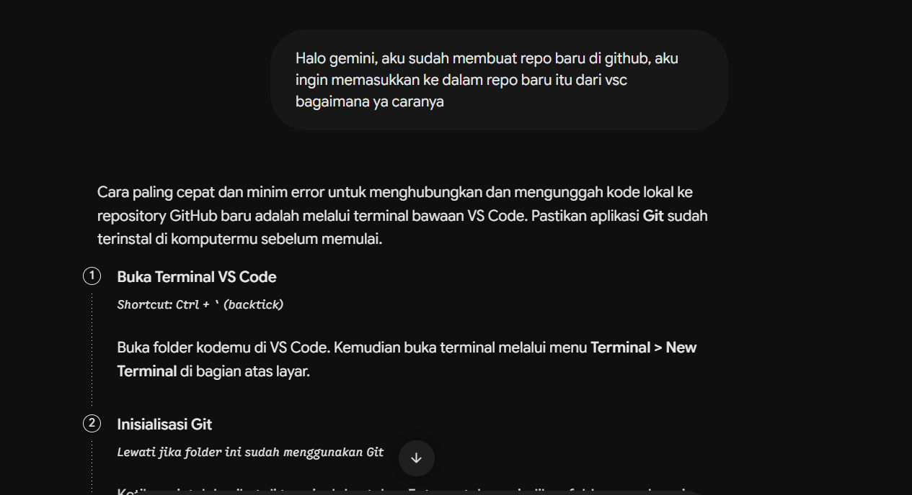
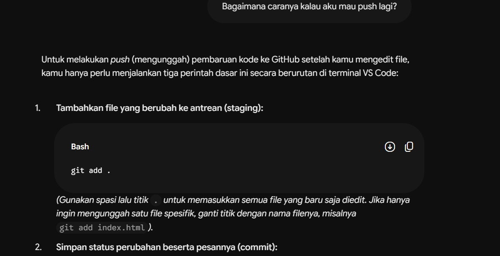
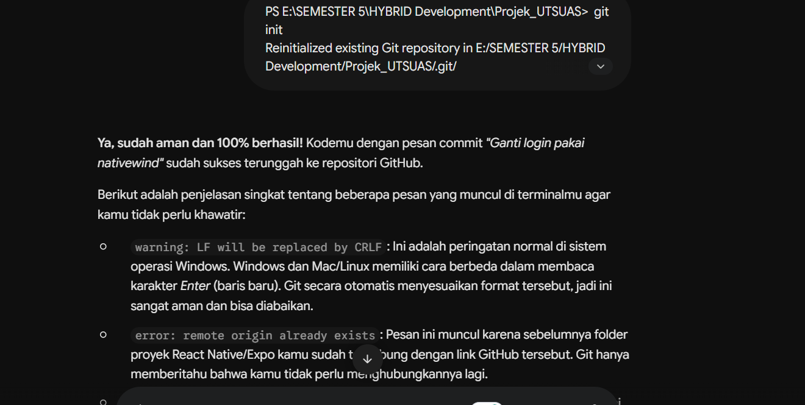
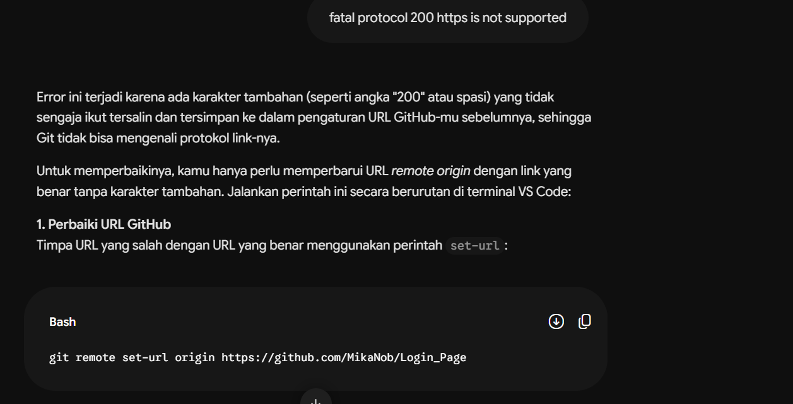
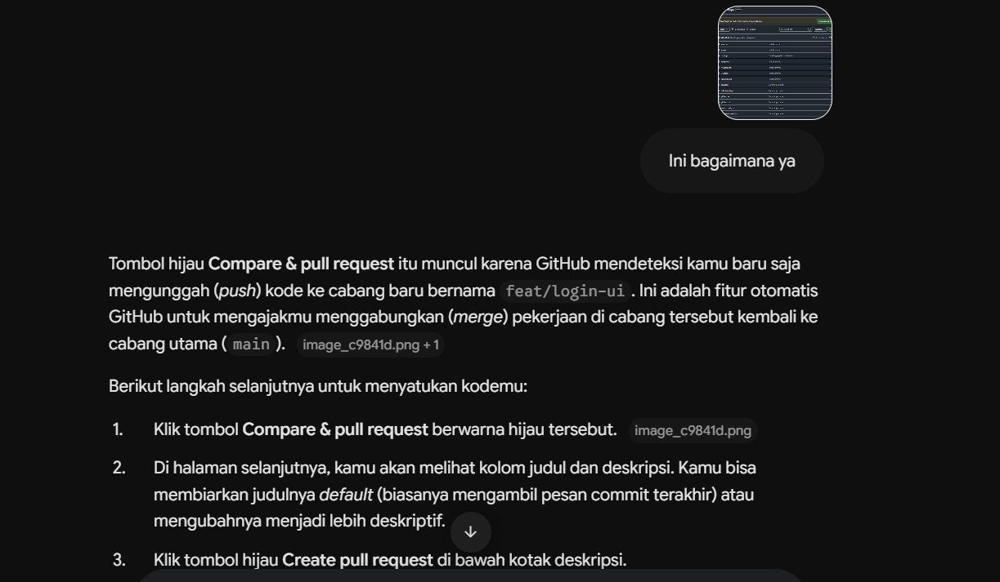
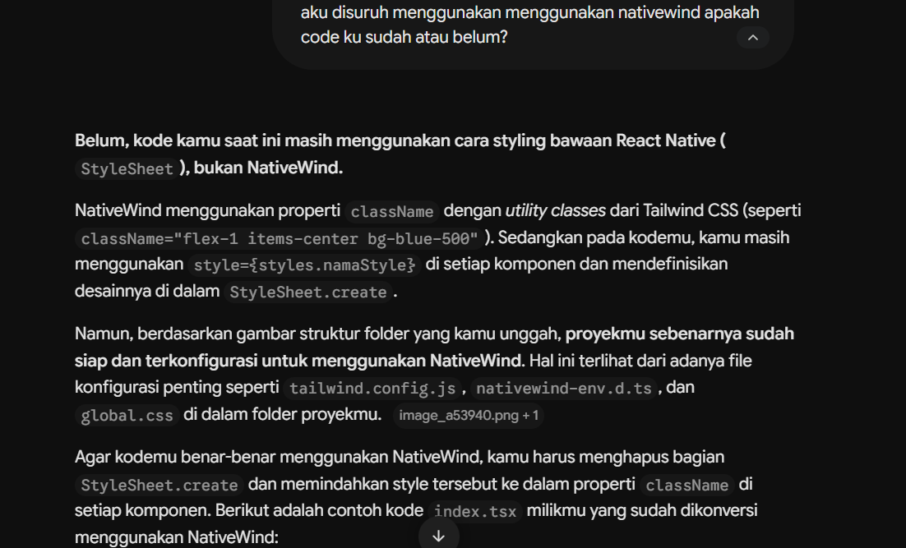
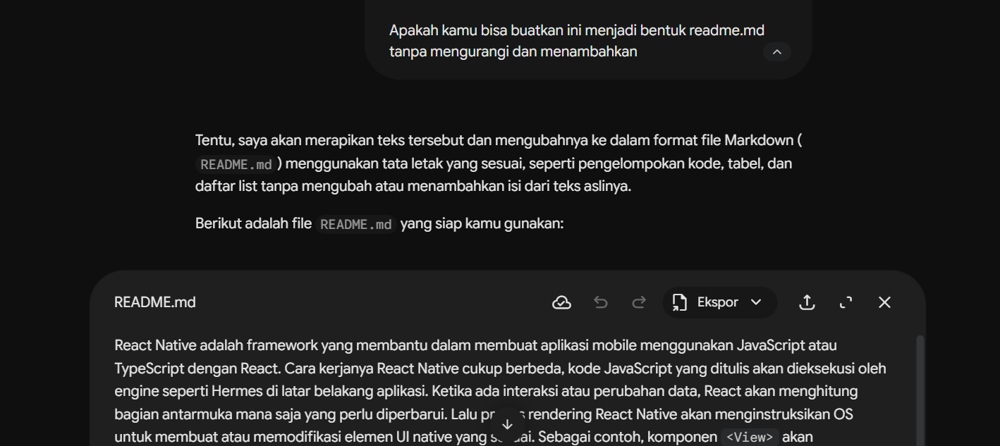

### 1. Menghubungkan proyek ke repository GitHub baru

### 2. Push perubahan berikutnya

### 3. Membaca pesan di terminal

### 4. Error `fatal: protocol '200 https' is not supported`

### 5. Tombol Compare & pull request di GitHub

### 6. Mengecek pemakaian NativeWind

### 7. Merapikan teks README

